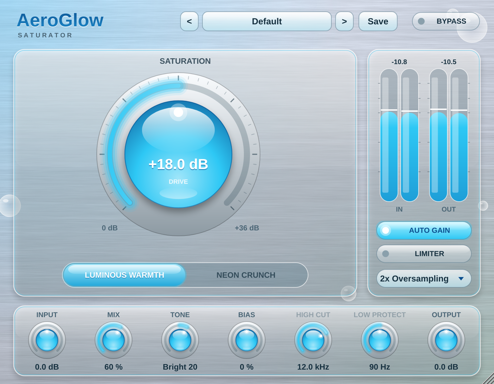
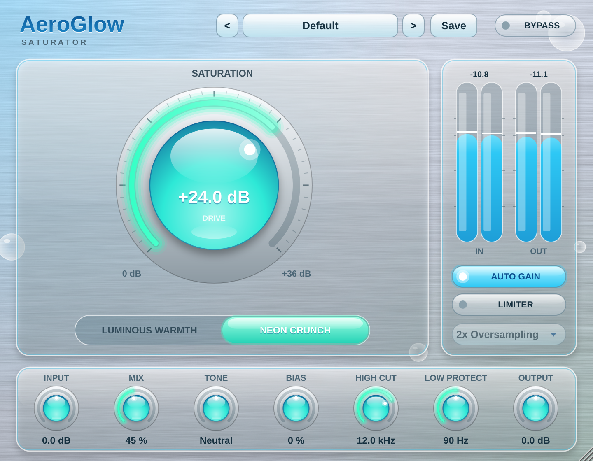

# AeroGlow Saturator

A two-mode saturation / distortion plug-in (VST3 · AU · AAX · Standalone) built with
C++20 and JUCE. It's tuned for the bright, glassy, optimistic "Frutiger Aero" sound
of the early 2000s, and it works on any source: vocals, pads, bass, drums, guitars,
buses and masters.

| Luminous Warmth | Neon Crunch |
|---|---|
|  |  |

*(These screenshots are rendered from the real editor by `AeroGlowSnapshot`, with audio running so the meters show signal.)*

---

## Contents
1. [The two modes](#1-the-two-modes)
2. [Architecture](#2-architecture)
3. [Parameters](#3-parameters)
4. [Building](#4-building)
5. [User guide](#5-user-guide)
6. [Testing](#6-testing) (details in [docs/TESTING.md](docs/TESTING.md))
7. [Troubleshooting, clamps & safety notes](#7-troubleshooting-clamps--safety-notes)
8. [Assumptions](#8-assumptions)
9. [Verification status](#9-verification-status)

---

## 1. The two modes

Both curves use the same bias-normalised form, `y = (S(x+b) − S(b)) / S'(b)`, which guarantees
`y(0) = 0` (moving Bias never causes a DC jump) and `y'(0) = 1` (quiet material passes at unity, so
level is governed by Drive alone). The non-linearity runs at the oversampled rate.

### Luminous Warmth: asymmetric biased tanh (triode-style)
```
S(u) = tanh(1.5·u)/1.5   for u ≥ 0      (firm half, ceiling ≈ 0.67)
S(u) = tanh(0.4·u)/0.4   for u < 0      (soft half, ceiling 2.5)
b    = 0.10 + 0.30·Bias
```
* The curve is smooth everywhere (C² at the joint, since tanh''(0) = 0), so there are no edges and no harsh HF.
* One half-cycle saturates about 4× earlier than the other, the way a triode clips on grid
  current. That keeps the **2nd harmonic dominant** even when driven hard: a symmetric tanh
  turns into a square wave, which is odd-only.
* There's a stereo-linked **soft-knee transient compressor** (−6 dB threshold relative to the rail,
  12 dB knee, 1.6:1, 2 ms / 80 ms, gain-smoothed). It rounds transients before the curve and
  engages more as Drive rises.
* Voicing: a "warmth" bell at 220 Hz (0 → +2.5 dB as Drive goes 0 → 36 dB) and an "aero air"
  shelf (+1.5 dB at 11 kHz).
* Oversampling is 2× by default, with 4× selectable.

### Neon Crunch: knee hard clip (transistor rail)
```
S(u) = u                                  |u| ≤ 0.96
S(u) = sgn(u)·(|u| − (|u|−0.96)²/0.16)    0.96 < |u| < 1.04
S(u) = sgn(u)                             |u| ≥ 1.04      (flat = hard clip)
b    = 0.25·Bias
```
* Peaks are cut flat, giving a dense **odd** harmonic series. It's perfectly symmetric at Bias 0, and Bias adds even grit.
* A +6 dB **pre-emphasis** shelf above about 1.6 kHz is applied before the clipper, with the exact inverse
  de-emphasis after it, so upper mids clip first ("edge"). For small signals the pair is an identity.
* **Bass protect**: an LR4 crossover (default 90 Hz) routes the lows *around* the clipper, so
  there's no sub blow-out and no intermodulation mud.
* **High Cut** (12 dB/oct, default 12 kHz, maximum position = Off) tames fizz, followed by a "neon glow" presence bell (+1.5 dB at 2.8 kHz).
* Oversampling is **always 4×**. The same knob position drives Neon 6 dB less hard than Luminous
  (a headroom shift that's given back after the clipper), giving the spec's "lower default drive".

### Measured signature (1 kHz, −12 dBFS, mix 100 %; from `AeroGlowCoreTests`)
| Mode | Drive | H2 | H3 | H5 | H7 | even | odd |
|---|---|---|---|---|---|---|---|
| Luminous | +18 dB | **−15.5** | −23.4 | −37.2 | −48.4 | **−15.5** | −23.2 |
| Neon | +18 dB | −150 | **−20.4** | −32.9 | −41.8 | −150 | **−20.1** |
| Neon | +30 dB | −150 | −11.4 | −17.9 | −22.9 | −150 | −10.3 |

---

## 2. Architecture

### File tree
```
AeroGlow/
├── CMakeLists.txt                 cross-platform build (JUCE via FetchContent or -DJUCE_DIR)
├── Source/
│   ├── dsp/                       ── JUCE-FREE DSP core (plain C++17; unit-testable anywhere)
│   │   ├── DspUtils.h             fastTanh (Padé 7/6), LinearSmoother, IntegerDelay
│   │   ├── Filters.h              TPT SVF (LP/HP/bell/shelf), one-pole, 1st-order shelf, TiltEq, LR4 crossover
│   │   ├── Waveshapers.h          LuminousCurve, NeonCurve (the two transfer functions)
│   │   ├── HalfbandOversampler.*  linear-phase polyphase half-band FIR, 2×/4×, integer latency
│   │   ├── ModeEngine.*           one complete wet path per (mode, oversampling); auto make-up table
│   │   └── SaturationProcessor.*  full chain: input → crossover → engines → tilt → mix → limiter → bypass
│   ├── Parameters.*               parameter IDs, ranges, defaults, text formatting, lock-free snapshot
│   ├── PluginProcessor.*          JUCE AudioProcessor shell: buses, latency, state, meters
│   ├── PresetManager.*            *.aerosat XML presets, factory install, next/prev
│   ├── PluginEditor.*             single-window UI (scalable 50–200 %)
│   └── gui/
│       ├── AeroLookAndFeel.*      brushed metal, glass panels, aqua orbs (all procedural)
│       ├── ModeSwitch.*           LUMINOUS | NEON segmented switch (ParameterAttachment)
│       └── LevelMeter.*           stereo IN/OUT peak meters with hold
├── Presets/                       example presets (embedded as BinaryData, installed on first run)
├── Tests/
│   ├── CoreTests.cpp              FFT harmonics, aliasing, latency, phase, auto-gain, clicks, robustness, CPU
│   ├── TestSignals.h              tone generator (sine, sweep, chord pad, drum loop, pink noise), FFT, WAV writer
│   ├── HostSmokeTest.cpp          loads the BUILT .vst3/.component via JUCE hosting (like a DAW)
│   └── EditorSnapshot.cpp         renders the editor to PNG
├── packaging/macos/make_pkg.sh    signed/notarised .pkg (VST3/AU/AAX/app)
├── packaging/windows/AeroGlow.iss Inno Setup x64 installer
├── scripts/build_macos.sh, build_windows.ps1
├── .github/workflows/build.yml    CI: Windows / macOS / Linux build + tests (+ auval)
└── docs/                          TESTING.md, screenshots, captured test output
```

### Signal flow
```
in ─┬───────────────────────────────────────────────────── raw delay (L) ─────┐ bypass
    └ ×Input → HPF 20 Hz → LR4 split @ LowProtect                             │ x-fade
          low + high (= allpass) ─────────────── dry delay (L) ─────────────┐ │ (S-curve)
          low·protect ─────────────────────────── delay (L) ───────┐        │ │
          high + low·(1−protect) → engines, Σ wₑ·engineₑ ──────────┤        │ │
                                                  wet = Σ + low ───┘        │ │
                                    Tilt(wet) → Mix(dry, wet) ──────────────┘ │
                                    ×Output → [safety limiter] ──────────────┘→ out

engine = [pre (compressor | pre-emphasis)] → ×Drive → ↑2×/4× (FIR) → curve → ↓ (FIR anti-alias)
         → DC-block → post/voicing (High Cut, bells, shelf) → auto make-up → latency pad
```
* There are **three engines**: Luminous 2×, Luminous 4× and Neon 4×. Mode and Oversampling select one, and the change
  crossfades over 30 ms using an equal-sum S-curve. A newly selected engine first **warms up silently** for
  `latency + 64` samples, so its filters are full of real signal before it's heard. That's what makes
  switching click-free (verified: worst discontinuity during 15 rapid switches ≈ steady state).
* **Latency is constant**: every engine is padded to the same total `L`. It's 55 samples at 44.1–96 kHz
  (1.25 ms at 44.1 kHz), 47 at 176.4/192 kHz and 0 at ≥ 352.8 kHz. It is reported via `setLatencySamples` in
  `prepareToPlay` and **never changes** with Mode or Oversampling, so automating those is PDC-safe.
* **Phase-coherent Mix**: the dry path gets the same crossover allpass and the same integer delay
  as the wet path, and the anti-alias FIRs are linear-phase. Measured wet-vs-dry phase at drive 0 is < 7°
  from 60 Hz to 12 kHz, and the 50 % mix is within 0.02 dB of the ideal (no comb filtering).
* **Parameter smoothing**: gains, drive, bias, mix, tilt, engine weights and bypass are ramped **per
  sample**. Filter cutoffs update every ≤ 64-sample chunk (the core always works in ≤ 64-sample chunks,
  so any host buffer size, including 1 sample, is fine).
* **Threading**: the audio thread reads parameters from `std::atomic<float>*` (no locks, no
  allocation). `prepare()` is the only allocating call. The meters use atomics, and the editor consumes them on a 30 Hz timer.
  There's no global or static state: each instance is fully independent.

### Oversampler design
Each stage is a Kaiser-windowed-sinc half-band FIR (β = 8.5, ≈ 85 dB stop-band) in polyphase form, so
only non-zero taps are multiplied. Stage 1 has 95 taps (centre 47) and stage 2 has 33 taps (centre 16). They're chosen so that
2× latency = 47 and 4× latency = 47 + 16/2 = 55, both **integers**, which is what allows exact dry alignment.

---

## 3. Parameters

All are host-automatable. IDs are a stable contract: never rename them.

| ID | Name | Range | Default | Notes |
|---|---|---|---|---|
| `inputGain` | Input Gain | −24…+24 dB | 0 dB | before everything |
| `drive` | **Saturation** | 0…+36 dB | +18 dB | big knob; Neon internally −6 dB |
| `mix` | Mix | 0…100 % | 50 % | phase-coherent linear crossfade |
| `tone` | Tone / Tilt | −100…+100 | 0 (Neutral) | ±6 dB tilt around 900 Hz, wet only |
| `bias` | Bias | −100…+100 % | 0 % | even/odd balance |
| `mode` | Mode | Luminous Warmth / Neon Crunch | Luminous | 30 ms crossfade |
| `highCut` | High Cut (Neon) | 2–20 kHz | 12 kHz | max position = Off |
| `lowProtect` | Low Protect (Neon) | 30–250 Hz | 90 Hz | LR4 bass bypass |
| `outputGain` | Output Gain | −24…+24 dB | 0 dB | after Mix |
| `autoGain` | Auto Gain | on/off | on | keeps loudness at the dry level |
| `limiter` | Safety Limiter | on/off | off | −0.3 dBFS ceiling, no look-ahead |
| `oversampling` | Oversampling | 2x / 4x | 2x | Luminous only (Neon always 4×) |
| `bypass` | Bypass | on/off | off | host bypass parameter, latency-kept |

**Presets / state**
* The session state is the APVTS tree as XML plus the preset name and plugin version. Older sessions load, because missing parameters
  keep their current or default value. Foreign or corrupt chunks are ignored.
* Preset files (`*.aerosat`) are human-readable XML in **real units** (dB, %, Hz). Unknown IDs are
  ignored and missing IDs fall back to defaults. Bypass is never part of a preset. Example:
  [`Presets/Neon Drum Bus.aerosat`](Presets/Neon%20Drum%20Bus.aerosat).
* Preset folder: Windows `%APPDATA%\AeroGlow Audio\AeroGlow\Presets`, macOS
  `~/Library/AeroGlow Audio/AeroGlow/Presets`, Linux `~/.config/AeroGlow Audio/AeroGlow/Presets`.
  The three example presets are copied there on first launch, without overwriting any user edits.

---

## 4. Building

### Prerequisites
| | Windows | macOS | Linux |
|---|---|---|---|
| Compiler | Visual Studio 2022 (17.8+), "Desktop C++" workload | Xcode 15+ | GCC 11+ / Clang 14+ |
| CMake | 3.22+ | 3.22+ | 3.22+ |
| JUCE | fetched automatically (tag 9.0.5), or `-DJUCE_DIR=<checkout>` | same | same |
| Extra | — | — | `libasound2-dev libx11-dev libxrandr-dev libxinerama-dev libxcursor-dev libxi-dev libxext-dev libfreetype-dev libfontconfig1-dev libgl1-mesa-dev` |

### Windows (Visual Studio)
```bash
cmake -S . -B build-win -G "Visual Studio 17 2022" -A x64
```
```bash
cmake --build build-win --config Release --parallel
```
```bash
ctest --test-dir build-win -C Release --output-on-failure
```
Or run `powershell -ExecutionPolicy Bypass -File scripts\build_windows.ps1`, or open
`build-win\AeroGlow.sln` in Visual Studio. Output: `build-win\AeroGlow_artefacts\Release\VST3\AeroGlow Saturator.vst3`
and `...\Standalone\AeroGlow Saturator.exe`. Use `--config Debug` for a debug build (with JUCE assertions and the leak detector).

### macOS (Xcode, Universal 2: Apple Silicon + Intel)
```bash
cmake -S . -B build-mac -G Xcode -DCMAKE_OSX_ARCHITECTURES="arm64;x86_64"
```
```bash
cmake --build build-mac --config Release --parallel
```
```bash
ctest --test-dir build-mac -C Release --output-on-failure
```
Or run `scripts/build_macos.sh`. Output: `.vst3`, `.component` (AU) and `.app` in
`build-mac/AeroGlow_artefacts/Release/`. Copy the AU to `~/Library/Audio/Plug-Ins/Components/`, then
validate it:
```bash
auval -v aufx AgSt Aero
```

### Linux (development / CI)
```bash
cmake -S . -B build -G Ninja -DCMAKE_BUILD_TYPE=Release
```
```bash
cmake --build build
```

### AAX (Pro Tools)
1. Download the AAX SDK from your Avid developer account.
2. Configure with `-DAEROGLOW_AAX_SDK_PATH=/path/to/aax-sdk`. AAX is added to the formats on Windows and macOS.
3. Pro Tools only loads **PACE-signed** AAX binaries. Sign with PACE `wraptool` using your iLok
   developer account, for example `wraptool sign --account … --wcguid … --in "AeroGlow Saturator.aaxplugin" --out …`.
   For development, use Pro Tools | Developer, which loads unsigned plug-ins.

### Options
| CMake option | Default | Meaning |
|---|---|---|
| `JUCE_DIR` | — | use a local JUCE checkout instead of FetchContent |
| `AEROGLOW_JUCE_TAG` | `9.0.5` | JUCE tag to fetch |
| `AEROGLOW_AAX_SDK_PATH` | — | enables AAX |
| `AEROGLOW_ENABLE_AVX2` | OFF | `-mavx2 -mfma` / `/arch:AVX2` for the DSP core. **Off by default** so the binary runs on every x64 CPU (SSE2 baseline). The core already runs at about 2 % of one core, so AVX2 is optional. Apple Silicon builds use NEON automatically. |
| `AEROGLOW_BUILD_TESTS` | ON | `AeroGlowCoreTests` (no JUCE needed) |
| `AEROGLOW_BUILD_HOST_TEST` | ON | `AeroGlowHostTest` and `AeroGlowSnapshot` |

### Packaging
* **macOS**: `packaging/macos/make_pkg.sh build-mac/AeroGlow_artefacts/Release 1.0.0` builds a `.pkg`
  with one checkbox per format. Set `APP_SIGN_ID`, `PKG_SIGN_ID` and `NOTARY_PROFILE` for Developer-ID
  signing and notarisation.
* **Windows**: `iscc /DVersion=1.0.0 packaging\windows\AeroGlow.iss` (Inno Setup 6) builds a setup .exe. Sign it with
  `signtool` (Authenticode).
* Before shipping, replace the placeholder plug-in codes (`Aero` / `AgSt`), the bundle ID and the company name in
  `CMakeLists.txt`. JUCE is dual-licensed (AGPLv3 / commercial), so pick the licence that fits your distribution.

---

## 5. User guide

**Quick start.** Insert AeroGlow on a track, pick a mode, and turn the big **Saturation** knob. With
**Auto Gain** on (the default), loudness stays put while you turn, so you hear the *colour*, not just
"louder". Use **Mix** to blend in parallel.

| Control | What it does |
|---|---|
| **Saturation** | Drive into the curve, 0 to +36 dB. Double-click resets to +18 dB. |
| **Mode** | *Luminous Warmth*: smooth, warm, 2nd-harmonic, glassy top. *Neon Crunch*: hard-edged, odd harmonics, punchy. |
| **Input / Output** | Gain staging before and after everything. Input also changes how hard the curve is hit. |
| **Mix** | Dry/wet, phase-aligned, so 50 % never sounds hollow. |
| **Tone** | Tilts the wet signal darker (−) or brighter (+) around 900 Hz. |
| **Bias** | Luminous: more (+) or less (−) 2nd harmonic. Neon: adds even-order grit to the clipper. |
| **High Cut** (Neon) | Tames fizz. All the way up = Off. |
| **Low Protect** (Neon) | Lows below this frequency skip the clipper and stay tight. |
| **Auto Gain** | Automatic make-up, calibrated to the dry loudness (±0.2 dB on pink noise). |
| **Limiter** | Safety ceiling at −0.3 dBFS for buses and masters. |
| **Oversampling** | Luminous only: 2× (light) or 4× (cleaner top end at extreme drive). Latency is unchanged. |
| **Bypass** | Click-free, keeps latency, so there's no timing jump. |

Mouse: drag (up/right increases), scroll wheel, double-click for the default, or type values into the small knobs' text
boxes (for example "12k", "−3 dB", "dark 40"). Resize the window from the bottom-right corner (50–200 %).

**Starting points**
| Source | Mode | Saturation | Mix | Other |
|---|---|---|---|---|
| Dreamy pads / keys | Luminous | +12…+18 | 50–70 % | Tone +20…+30, 4× OS |
| Lead vocal | Luminous | +9…+14 | 25–40 % | Tone +10…+15 |
| Bass | Luminous | +15…+24 | 60–100 % | Bias +20 for more growl |
| Drum bus | Neon | +16…+24 | 35–50 % | Low Protect 100–120 Hz, Limiter on |
| Synth lead / arp | Neon | +20…+30 | 60–100 % | High Cut 9–12 kHz |
| Gritty guitar | Neon | +24…+36 | 100 % | High Cut 7–9 kHz, Bias +30 |
| Mix bus / master | Luminous | +4…+9 | 20–35 % | Limiter on, Output to taste |

---

## 6. Testing

```bash
./build/AeroGlowCoreTests                    # 40 checks + CPU benchmark (JUCE-free)
```
```bash
./build/AeroGlowCoreTests --wav out_dir      # also renders sweep / pad / drum loop through both modes
```
```bash
./build/AeroGlowHostTest_artefacts/Release/AeroGlowHostTest "build/AeroGlow_artefacts/Release/VST3/AeroGlow Saturator.vst3"
```

What the tests cover: fastTanh accuracy, curve shapes, first output samples of a sine, the
FFT harmonic signature per mode and drive, aliasing at 1×/2×/4×, latency alignment at 44.1–384 kHz, bit-exact bypass,
wet/dry phase coherence, auto-gain accuracy, click-free switching, randomised automation with NaN, Inf, +24 dBFS
and DC input at 9 sample rates, the safety-limiter ceiling, CPU use, plus the host-level load, latency, automation, state and editor checks. The full
procedure, captured outputs, the meter table and the per-control verification checklist are in
**[docs/TESTING.md](docs/TESTING.md)**.

---

## 7. Troubleshooting, clamps & safety notes

| Situation | Behaviour / fix |
|---|---|
| Host sends out-of-range or NaN parameter values | Every value is clamped in `SaturationProcessor::setParameters`, and a NaN falls back to the default. |
| NaN/Inf **audio** from upstream | Replaced with 0 before any filter. A final output guard zeroes the chunk and resets state if anything non-finite ever appears (it has never fired in testing). |
| Very high sample rates | ≥ 176.4 kHz: one oversampling stage fewer. ≥ 352.8 kHz: no oversampling (already far above audio band, avoids huge CPU). |
| Invalid sample rate (0, NaN, < 8 kHz, > 1.536 MHz) | Falls back to 44.1 kHz coefficients instead of producing garbage. |
| Huge host buffers (8192+) or 1-sample buffers | Processed internally in ≤ 64-sample chunks. Nothing is sized from the host block size. |
| Mono tracks | Mono→mono and stereo→stereo layouts are supported. Other layouts are rejected (`isBusesLayoutSupported`). |
| "Plug-in is louder than bypass" | Turn on Auto Gain. Calibrated on broadband material, it's within ±0.2 dB. Very narrow-band material (a dense low pad chord) can land 1–3 dB off, so trim with Output. |
| Hard clipping a 5 kHz+ tone at +30 dB sounds grainy | That's physics: Neon at 4× still leaves about −37 dB of audible aliasing on that extreme case (−74 dB for Luminous at 4×). Use High Cut, less Drive, or Luminous. |
| Pro Tools doesn't list AAX | It must be PACE-signed (see §4), or use Pro Tools Developer. |
| Logic doesn't show the AU | Run `auval -v aufx AgSt Aero`. Make sure the bundle is in `~/Library/Audio/Plug-Ins/Components`, and kill `AudioComponentRegistrar` to rescan. |
| macOS "damaged / can't be opened" | The bundle isn't signed or notarised: use `make_pkg.sh` with your Developer ID. |

**Safety notes / dependencies**
* JUCE modules used: `juce_audio_utils` and `juce_dsp` (and their dependencies). The DSP core itself uses **no** JUCE DSP classes.
  The oversampler, filters and smoothing are our own, so behaviour doesn't change across JUCE versions.
* There's no `-ffast-math` and no MSVC `/fp:fast`, because the non-finite guards rely on IEEE semantics. Denormals are flushed with
  `juce::ScopedNoDenormals` plus explicit undenormalising of filter states.
* There's no allocation, no locks and no I/O on the audio thread. Preset I/O is message-thread only.

---

## 8. Assumptions
Where the spec left details open, these assumptions were made. Each is also commented in the code.
1. **JUCE 9.0.5** is the "latest stable" (Nov 2026). Only long-stable APIs are used.
2. **Saturation range is 0…+36 dB.** The spec's "−∞" end is interpreted as *0 dB = minimum drive*: both curves
   have unity slope at 0, so the bottom of the knob is nearly linear. Mix 0 % is the true "no effect".
3. **Mode is a 2-position switch.** "Off" is covered by the separate Bypass button.
4. **Oversampling defaults to 2×** (spec item 8), and **Neon is always 4×** (spec item 4). This is reconciled by letting the Oversampling
   parameter apply to Luminous only, with constant latency across all combinations.
5. **Neon's "lower default drive"** is a fixed −6 dB headroom shift on the shared knob, not a mode-dependent default.
   A parameter can't have per-mode defaults without breaking automation recall.
6. **Filter defaults**: input HPF at 20 Hz (12 dB/oct); Neon Low Protect at 90 Hz (LR4); High Cut at 12 kHz (12 dB/oct, Off at
   max); DC blocker at 7 Hz after the curve; tilt pivot at 900 Hz, ±6 dB.
7. **Anti-aliasing**: a half-band transition (≈ 0.45–0.55 fs) means components folding into 20–24 kHz (at 48 kHz) are
   inaudible by design. The tests measure aliasing in the 20 Hz–20 kHz band.
8. **Tone and voicing filters are wet-only** (minimum-phase). Wet/dry phase coherence is guaranteed and tested at
   neutral Tone with High Cut Off. Moving Tone or High Cut intentionally changes the wet signal's phase a little.
9. **The safety limiter has no look-ahead**, to keep latency minimal. It isn't meant to be a mastering limiter.
10. **Supported host sample rates** are 8 kHz–1.536 MHz, tested at 22.05–384 kHz.
11. Plug-in IDs, company name and bundle ID are **placeholders**.

## 9. Verification status
| Item | Status |
|---|---|
| DSP core tests (40 checks) | ✅ run and passing (Linux x64, GCC 13, Release) |
| Plugin build: VST3 + Standalone | ✅ compiled warning-free under JUCE's strict warning flags (Linux) |
| Host smoke test: load VST3 via JUCE hosting, latency, automation (19,711 blocks), state, editor | ✅ passing (Linux) |
| Editor rendering | ✅ screenshots above, rendered from the real editor |
| Windows (MSVC) / macOS (Xcode, Universal 2) / AU / auval | ⚙️ **not compiled in this environment.** The CI workflow (`.github/workflows/build.yml`) builds and tests all three OSes and runs `auval`. Run it, or the scripts in §4, before release. |
| AAX | ⚙️ needs the Avid SDK and PACE signing (not freely distributable), see §4 |
| DAW acceptance (FL Studio, Studio One, Ableton Live 12, Cubase 12, Logic 11, Pro Tools 2024) | ⚙️ manual checklist in [docs/TESTING.md](docs/TESTING.md#4-daw-acceptance-checklist) |
