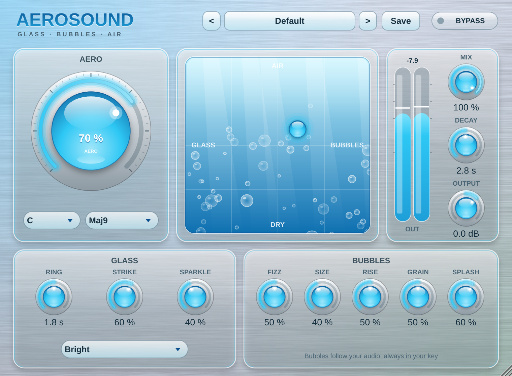

# AEROSOUND

**Glass · Bubbles · Air.** AEROSOUND is an audio effect (VST3 · AU · Standalone; AAX-ready) that
turns any sound into the bright, glassy, bubbly world of the early-2000s "Frutiger Aero"
aesthetic. Put it on vocals, drums, keys, pads, guitars or whole buses.



## What it does
| Element | What you hear | How it works |
|---|---|---|
| **Glass** | Your sound rings like tuned crystal bowls. Drum hits tap a glass chord. | A bank of in-key modal resonators (twin-detuned for shimmer, plus octave partials), a mallet strike on transients, a sparkle exciter, and auto-levelling |
| **Bubbles** | Rising, popping "bloops", in key, plus bubbles made from your own sound | A physical bubble model (decaying sine with rising pitch) and rising-pitch grains of the input. Both follow the input level, so silence means no bubbles. |
| **Air** | A bright, clean space around it all | An 8-line FDN reverb, high-passed so it never gets muddy |

Everything that rings or pops is **tuned to your Key and Chord**, so it always fits the song.

## Controls
* **AERO**: the main amount. One knob for the whole effect.
* **XY pad (the aquarium)**: left = Glass, right = Bubbles, middle = both; up = more Air.
  Double-click to centre. The bubbles inside react to your audio.
* **Key / Chord**: the harmony everything is tuned to. Maj9, Add9 and Pentatonic sound the most "Aero".
* **Glass**: Ring (decay), Strike (rings with everything ↔ only on hits), Sparkle, Register (Mellow / Bright / Icy).
* **Bubbles**: Fizz (amount), Size (tiny/high ↔ big/low), Rise (pitch glide), Grain (synth bubbles ↔ bubbles of your sound), Splash (bursts on hits).
* **Mix**, **Decay** (air length), **Output**, **Bypass** (click-free).
* **8 factory presets**: Bubble Vocal, Aquarium Drums, Crystal Keys, Aero Sky Pad, Underwater Bloops, Icy Bells Guitar,
  Glass Bus Gloss, Fizzy Arp Dream. Save your own with **Save**.
  Presets live in `%APPDATA%\AeroSound\Presets` (Windows) or `~/Library/AeroSound/Presets` (macOS).

Technical: zero latency, mono→stereo and stereo→stereo, every parameter automatable, state saved with the session.

## Download / install
Every push builds Windows, macOS (Universal: Apple Silicon + Intel) and Linux on GitHub Actions.
Open the latest run under **Actions** and download **AEROSOUND-Windows** or **AEROSOUND-macOS** from *Artifacts*.
* **Windows**: copy `Release\VST3\AEROSOUND.vst3` to `C:\Program Files\Common Files\VST3\`
* **macOS**: copy `Release/VST3/AEROSOUND.vst3` to `/Library/Audio/Plug-Ins/VST3/` and
  `Release/AU/AEROSOUND.component` to `/Library/Audio/Plug-Ins/Components/`
* Rescan plugins in your DAW. In Studio One, use **Options → Locations → VST Plug-Ins → Reset Blocklist** if needed.

## Building
```bash
cmake -S . -B build -DCMAKE_BUILD_TYPE=Release
```
```bash
cmake --build build --config Release
```
On Windows, use Visual Studio 2022 or newer. On macOS, use Xcode (`-G Xcode`). JUCE (9.0.5) is fetched automatically.
`AeroSoundDemos <dir>` renders before/after listening demos without a DAW, and `AeroSoundHostTest <plugin>`
loads the built plugin like a DAW and checks it.

## Before selling
* Replace the placeholder plugin codes (`AeSn` / `AeSd`) and bundle ID in `CMakeLists.txt`.
* Check that the name "AEROSOUND" is free to trademark in your market.
* Code-sign: Apple Developer ID plus notarisation (`packaging/macos/make_pkg.sh`), and a Windows Authenticode
  certificate for the installer (`packaging/windows/AeroSound.iss`).
* JUCE licence: check the tier that fits your revenue at juce.com.

## Source layout
```
Source/aerosound/   JUCE-free DSP: GlassEngine, BubbleEngine, SpaceReverb, AeroSoundProcessor
Source/dsp/         shared filters/utilities (+ the older AeroGlow saturator core)
Source/gui/         AeroLookAndFeel (glass/metal skin), XYPad (animated aquarium), LevelMeter
Source/*.cpp        JUCE plug-in shell: processor, editor, parameters, presets
Presets/            factory presets (*.aerosound, embedded into the binary)
Tests/              demo renderer, host smoke test, editor snapshot, DSP core tests
```
